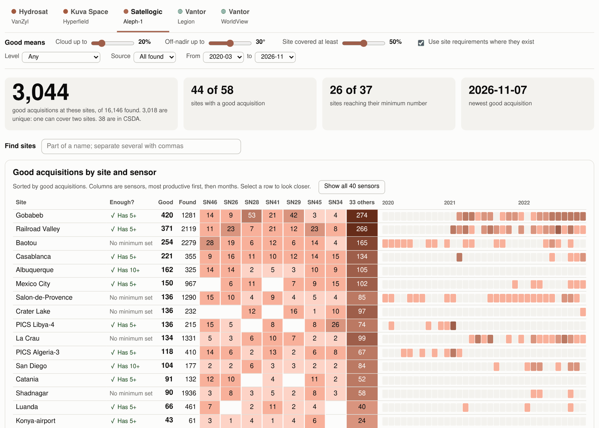
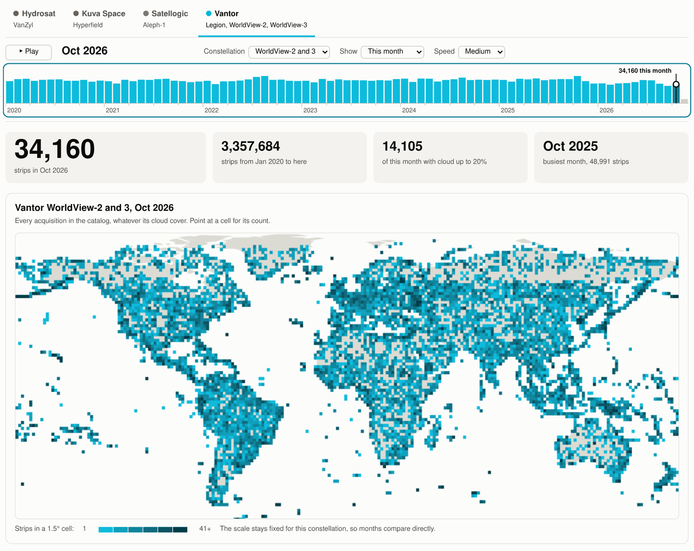
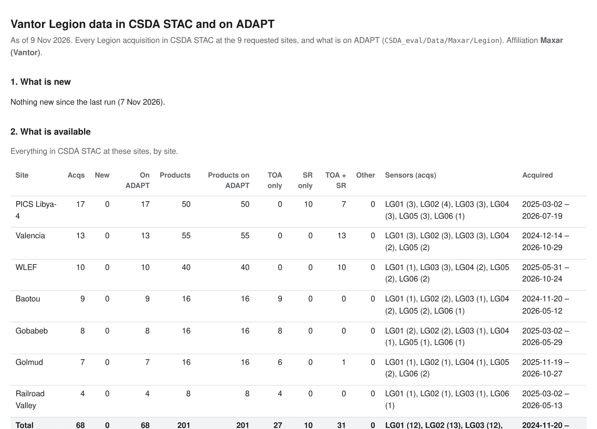
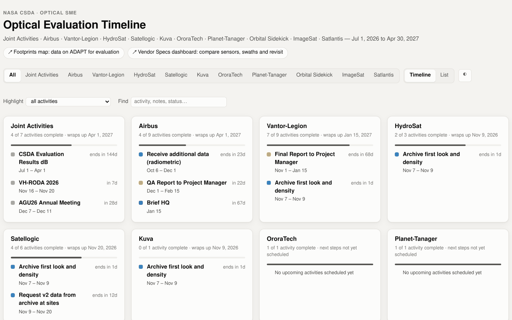
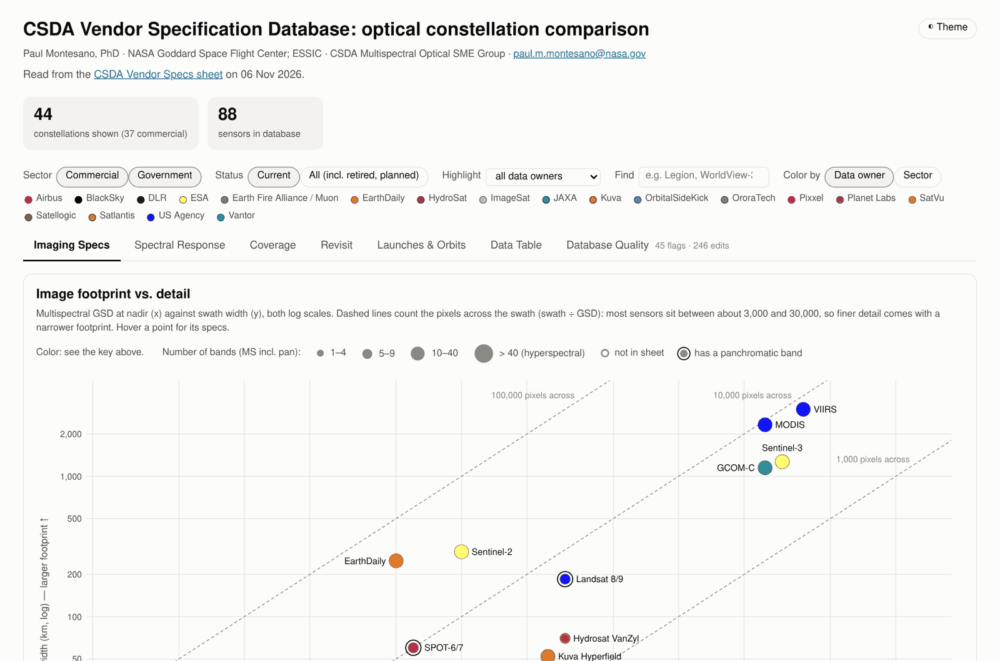
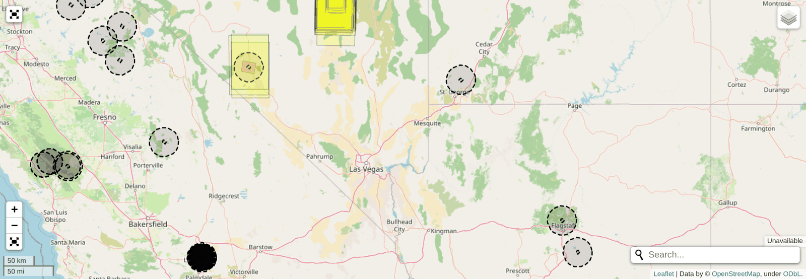
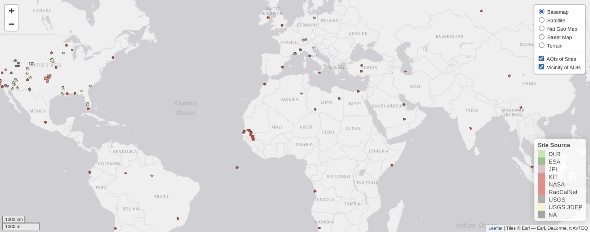

# CSDA Summaries

### Live pages and tools for the CSDA Multi-/Hyper-spectral Optical SME Groups

NASA's Commercial SmallSat Data Acquisition (CSDA) program evaluates imagery from commercial satellite companies. The subject matter
experts (SMEs) in the Multi-/Hyper-spectral Optical SME Groups run those evaluations at a set of evaluation sites around the world.

This repository uses a database of our evaluation sites to summarize vendor catalogs, orders and deliveries and displays them on **web pages anyone on the team can open in a browser**: what imagery
exists at each site, what has been delivered, what is ready to use, and where each evaluation stands.

| Author | Affiliation |
|----------|----------|
| Paul Montesano, PhD | NASA Goddard Space Flight Center - Earth System Science Interdisciplinary Center, U. Maryland-College Park |

---

## The pages at a glance

| Page | What it answers |
|---|---|
 [**Vendor Specs dashboard**](https://pahbs.github.io/csda_summaries/html/vendor_specs.html) | How do the satellites compare in detail, coverage, bands and revisit? |
| [**Vendor archive first look**](https://pahbs.github.io/csda_summaries/html/archive_first_look.html) | How many good images does each vendor's archive hold at my site, from each satellite? |
| [**Vendor archive density**](https://pahbs.github.io/csda_summaries/html/archive_density.html) | Where and how often has each constellation collected, month by month since 2020? |
| [**Evaluation timeline**](https://pahbs.github.io/csda_summaries/html/timeline.html) | Where does each vendor evaluation stand, and what is next? |
|
| [**Footprints map**](https://pahbs.github.io/csda_summaries/html/footprints_csda_map.html) | Which delivered images sit on ADAPT, and where exactly? |
| [**CSDA evaluation sites map**](https://pahbs.github.io/csda_summaries/html/aoi_csda_sites_map.html) | Where are the CSDA evaluation sites, and what is each one for? |
| [**SLI evaluation sites map**](https://pahbs.github.io/csda_summaries/html/aoi_eval_sites_map.html) | Where is the broader set of SLI evaluation sites, and what is each one for? |
| [**Data tracking: Airbus**](https://pahbs.github.io/csda_summaries/html/augmentation/airbus_augmentation_summary.html) and [**Vantor Legion**](https://pahbs.github.io/csda_summaries/html/augmentation/legion_augmentation_summary.html) | What has arrived for my sites, is it on ADAPT, and what is still to come? |

---

## Vendor archive first look

**Start here when choosing data for a site.** For each vendor, the page counts the *good* acquisitions at every evaluation site, from
each satellite. You decide what good means (cloud cover, viewing angle, how much of the site an image covers), or use each site's own
requirements. A green check shows when a site has enough.

- Type a site name in **Find sites** to see just your sites, across every vendor
- See why images fall short: too cloudy, too oblique, or the site only partly covered
- Download the good candidates as a CSV, then check their thumbnails before ordering

---

## Vendor archive density

**See where and when each constellation collects.** Monthly world maps from each vendor's own catalog, from 2020 to today. Press
Play or drag along the timeline to watch collection grow, or switch to a running total. Vantor's Legion and WorldView satellites can be
viewed separately or together.

---

## Data tracking: what has arrived for your sites

**Know what is ready to use.** For the vendors with active orders, each page answers three questions in the same order:

1. **What is new** since the last check
2. **What is available**, site by site, with the products and processing levels explained in plain terms
3. **What is on ADAPT**, ready to work with, and what is still to come from the vendor

The pages also translate between vendors: the same idea often has different names, and "TOA" from one vendor is not the same
product as "TOA" from another.

---

## Evaluation timeline

**One view of every evaluation.** Activities, briefings, data deliveries and reports for each vendor, with the latest status notes and
links to all of the pages above.

---

## Vendor Specs dashboard

**Compare the satellites themselves.** Image detail against footprint size, spectral bands, coverage, revisit, and launch history for
commercial and government optical constellations, filtered by sector, status or data owner. Vendor colors here carry through to the
archive pages.

---

## Imagery on ADAPT and the evaluation sites

**Find what has been delivered, and where.** The footprints map outlines every evaluation image held on ADAPT, colored by vendor and
satellite, over the evaluation sites. Point at a footprint for its details.

The evaluation sites themselves are kept as a single GeoJSON file of areas of interest (AOIs), shown on the
[CSDA evaluation sites map](https://pahbs.github.io/csda_summaries/html/aoi_csda_sites_map.html).

**Figure.** The CSDA evaluation sites, each shown with a 25 km buffer and colored by the source of the site. Select the image to open
the interactive map.

---

## How it works

- **One search, many catalogs.** A single search tool (`lib/multistac.py`) reads CSDA's catalog and each vendor's own catalog the same
  way, so every vendor is counted on the same terms. Adding a vendor means adding a short description of its catalog to
  `lib/stac_providers.yaml`.
- **Notebooks refresh the pages.** Each page is rebuilt by a notebook in `notebooks/`. Re-running it updates the page, and pushing the
  change to GitHub publishes it.
- **Pages stand on their own.** Every page is a single HTML file in `html/`, served by GitHub Pages. No server or login is needed to
  view them.

| To refresh | Run |
|---|---|
| Vendor archive first look | `notebooks/multistac_site_analysis_<vendor>.ipynb` (Hydrosat, Kuva, Satellogic, Legion and WorldView) |
| Vendor archive density | `python lib/archive_density.py fetch <vendor>`, then `python lib/archive_density.py build` |
| Data tracking pages | `notebooks/airbus_order_tracking.ipynb`, `notebooks/vantor_legion_supp_tracking.ipynb` |
| Footprints map | `notebooks/footprint_CSDA_eval_all_data.ipynb` |
| Timeline | `notebooks/timeline.ipynb` |

## Repository layout

| Folder | Contents |
|---|---|
| `html/` | The published pages |
| `notebooks/` | The notebooks that search, track, download and build the pages |
| `lib/` | Shared code: catalog search, order tracking, page builders |
| `sites/` | Evaluation site areas of interest (GeoJSON) |
| `LOG.md` | What changed and when, newest first |

## Contact

Paul Montesano · CSDA Multi-/Hyper-spectral Optical SME Groups · [paul.m.montesano@nasa.gov](mailto:paul.m.montesano@nasa.gov)
